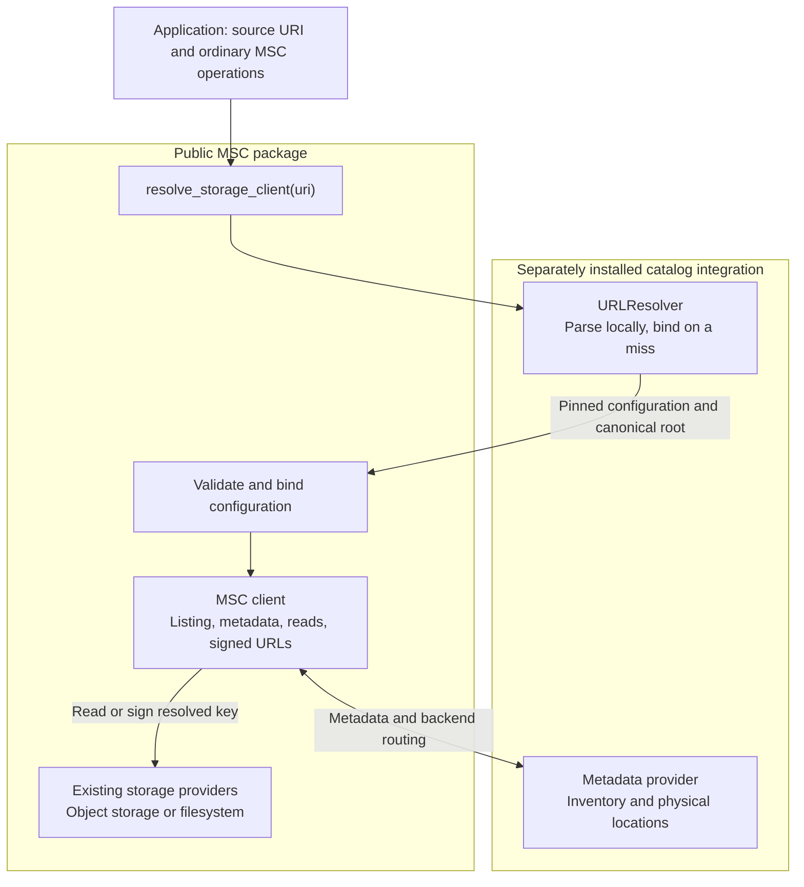
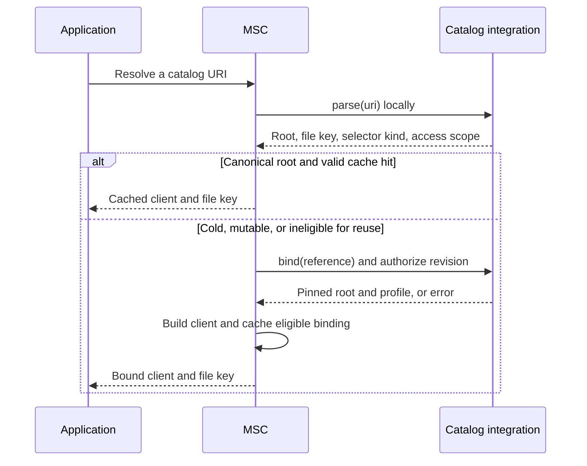

# Configurable reference resolution in MSC

**Status:** Draft for interface review. All APIs and configuration below are proposed unless marked existing.

## Problem and scope

A dataset catalog maps a dataset name and revision to a logical file inventory and backing storage locations. Today catalog access requires dataset-specific profile or provider configuration; `msc://profile/path` assumes that binding already exists. This proposal lets a configured resolver construct it from a reference URI. Applications continue to use MSC's existing listing, reading, and signing APIs.

Dataset Storage Service (DSS) is a motivating integration. Its external `nvdataset` provider resolves logical dataset paths to physical object locations, while MSC storage providers access the bytes. [Merged PR #190](https://github.com/NVIDIA/multi-storage-client/pull/190) describes this separation and identifies the provider as external to MSC. The proposed resolver follows the same boundary: service-specific parsing, authentication, and catalog access belong in the integration package. The examples use a fictional `catalog://` service and require no DSS installation.

The first delivery supports read-only dataset revisions through the Python API and existing storage backends. Catalog writes, automatic replica discovery, virtual-dataset materialization, and a general immutable-content API are outside scope. A pinned catalog revision fixes the inventory; it does not guarantee unchanged bytes in externally mutable objects.

## Public interface and ownership



Reuse the existing `provider_bundle` extension and `ProviderBundleV2` for metadata and backend delegation. Add one resolver per configured, non-reserved URI scheme, using MSC's existing `type` / `options` extension convention:

```yaml
url_resolvers:
  catalog:
    type: example_catalog.MSCResolver
    options:
      connections:
        research:
          endpoint: https://catalog.example.org
          namespace_id: ns-7f91
```

`example_catalog.MSCResolver` is illustrative. MSC constructs it as `MSCResolver(**options)`; the integration defines connection and authentication options. Configure the connection once, rather than defining a profile for each dataset. Import only explicitly configured classes, lazily when their scheme is used. Duplicate registrations and replacement of built-in schemes are configuration errors.

Proposed additions in `multistorageclient.references`:

```python
@dataclass(frozen=True)
class ParsedReference:
    root_url: str
    relative_path: str
    is_canonical: bool
    access_scope: str | None

@dataclass(frozen=True)
class BoundProfile:
    profile_config: dict[str, Any]
    canonical_root_url: str
    reuse_until: datetime | None

class URLResolver(Protocol):
    def parse(self, url: str) -> ParsedReference: ...
    def bind(self, reference: ParsedReference) -> BoundProfile: ...
```

`parse` uses the URI and local caller context to return the dataset root and decoded file key. It performs no I/O. It sets `is_canonical` only for an immutable dataset identifier and concrete revision in the integration's canonical syntax. `access_scope` is a non-secret identifier for the effective authorization context. If the integration cannot identify a safe reuse scope locally, it returns `None` and MSC bypasses reuse. Each configured resolver instance belongs to one loaded configuration.

`bind` authorizes the revision under the captured caller context. If `access_scope` is set, the integration must authorize that exact scope or fail. It returns a canonical root ending in `/` and one JSON-compatible MSC profile. For canonical input, MSC requires the returned root to equal the parsed input root before constructing or caching a client. For mutable input, the returned root must parse as canonical. The profile uses trusted deployment configuration for extension classes and credential providers, and contains no issued credentials. Catalog inventory and per-file access checks remain the metadata provider's responsibility.

Keep the existing `resolve_storage_client(url) -> tuple[StorageClient, str]`. Add `StorageClient.url(path: str = "") -> str`, returning the canonical root plus the encoded logical key for resolver-created clients. Existing profiles retain `msc://profile/path` formatting. Use this formatter consistently in URL-bearing list/glob results and `Path` operations.

## Resolve once and reopen elsewhere

The example integration accepts a mutable address and returns a pinned reference:

```text
Input:     catalog://research/datasets/by-name/images/revisions/latest/files/
Canonical: catalog://ns-7f91/datasets/by-id/d123/revisions/r42/files/
```

The integration owns this grammar. Here `research` is a local alias and `ns-7f91` identifies the catalog namespace. Persisted URIs include the stable namespace as well as dataset and revision. On bind, the integration uses local credentials and verifies the connected catalog's namespace against that identity. An unknown namespace, an alias pointed at another catalog, or a redirect from a pinned revision to another revision must fail.

```python
import multistorageclient as msc

client, root = msc.resolve_storage_client(source_uri)
pinned_root = client.url(root)

for item in client.list(root):
    source_reference = client.url(item.key)
    # Save or send source_reference to another process.
```



For example, after opening `r42/files/a.jpg`, opening `r42/files/b.jpg` in the same scope finds the existing client by **(loaded resolver configuration, access scope, canonical root)** before calling `bind`. The file key is returned separately. Cache successful binds under the canonical root and the scope actually authorized. `reuse_until` is the integration's UTC deadline for local reuse under its authorization policy. A missing deadline or scope disables caching. A changed scope or expired deadline forces a new bind. An explicit `latest` always runs `bind` and may seed the pinned entry for the revision it selects. Workers receive the canonical URI and authorize that exact revision with their own credentials on first use.

For previews or remote consumers, reopen the stored reference and request a fresh signed URL when the backend supports signing. Signed URLs are temporary transport addresses. Filesystem access does not imply an HTTP-signing capability.

## Required behavior and compatibility

- **Resolution order:** each registered scheme has one owner. Reject configurations that register a resolver and a path mapping for the same scheme. Existing unregistered schemes keep their path-mapping and implicit-profile behavior. An unknown scheme, missing integration, or failed bind raises an error.
- **Reconstruction:** carry the canonical URI, resolver identity (scheme and namespace), and read-only mode in the bound `StorageClientConfig`. Serialize bound configs, clients, and paths by reference, including configs rewrapped by sync. A new resolution or unpickle parses the URI in the receiving caller's context and authorizes the pinned revision before building providers. Unpickling also verifies the recorded resolver identity. After fork, invalidate inherited grants, providers, and open streams. On first data access through an inherited client or path, require the child's credentials to authorize its recorded scope. If that scope is absent or differs from the child's current scope, reject the handle. The child can explicitly reopen the canonical URI under its own scope.
- **Cache isolation:** give the registry a finite capacity and evict expired entries. Derive the generated profile identity from configuration, scope, and pinned root so disk caches, path comparisons, and sync checks distinguish bindings. The integration must enforce expiry and revocation on data access through retained clients, including cached reads. Disable shared content caching when the integration cannot identify a safe scope.
- **Path fidelity:** encode and decode logical keys exactly once. Preserve `%`, `?`, `#`, Unicode, literal dot segments, and trailing slashes in resolver-backed paths as well as emitted URIs. Keep the exact key alongside the bound client when deriving child paths.
- **Delegation:** listing uses the metadata inventory; reads and signing resolve the logical key and selected backend first. Test single- and multi-backend clients. Missing inventory entries must not be recovered by guessing physical paths.
- **Read-only enforcement:** propagate read-only mode into every single, composite, child, and replica client. Enforce it at each delegate, including when accessed through `client.delegate` or rebuilt by sync. Reject mutating operations, writable file modes, and signing other than GET/HEAD before side effects. Force declared replicas to read-only (no backfill on a read miss) and reject metadata autocommit before starting any threads or exit handlers.
- **Concurrency:** run catalog binding and provider construction outside shared cache locks. Coordination on one binding must allow unrelated bindings and existing storage URLs to resolve independently.

Explicit profiles continue to work without a resolver. Deploy an MSC version that recognizes `url_resolvers` before distributing a shared config containing it. Older clients reject unknown top-level config keys. Python owns resolver dispatch and uses the existing Rust storage interfaces. Explorer, MCP, and framework-specific URL validators require a separate entrypoint audit before claiming support there.

## Implementation and acceptance

Paths are relative to the repository root.

| Files | Planned change |
|---|---|
| Under `multi-storage-client/src/multistorageclient/`: `references.py` (new), `config.py`, `schema.py`, `shortcuts.py` | Resolver contract/loading, validated bound configuration, dispatch, cache isolation. |
| Under `multi-storage-client/src/multistorageclient/`: `client/{client,types,single,composite}.py`, `pathlib.py`, `file.py`, `replica_manager.py` | Preserve the binding through delegates, sync, file handles and derived paths. Enforce read-only mode and prevent replica backfill. |
| `multi-storage-client/tests/test_multistorageclient/unit/` | Extend config, shortcuts, client, pathlib, serialization, and Ray tests with a synthetic catalog integration. |
| Under `multi-storage-client-docs/`: `src/user_guide/{concepts,quickstart}.rst`, `src/references/{configuration,api}.rst`, `examples/quickstart.ipynb` | Explain resolver configuration, canonical references, and application usage. |
| `.release_notes/.unreleased.md` | Describe the additive reference-resolution feature. |

Acceptance requires:

- [ ] Resolve, list, read, and sign a synthetic dataset whose logical and physical keys differ, with one and multiple backends. Assert zero writes, including queued uploads after a replica miss, writes through a delegate or sync destination, and write-method signing.
- [ ] Reopen emitted URIs with connection-level configuration. Exercise `Path`, pickled config/client, fork, and Ray handoff. Denied workers and forked children using an inherited handle under a different scope must fail before storage I/O. A second catalog serving the same dataset/revision IDs, or a resolver returning a different canonical revision, must also fail.
- [ ] A new `latest` resolution can advance while existing clients and saved references remain pinned; isolate revisions and caller contexts in caches and path comparisons.
- [ ] Preserve exact keys and existing explicit-profile/path-mapping/storage-URL behavior; fail clearly on missing plugins, ambiguous names, unavailable revisions, and denied access.

### Performance criteria for the implementation PR

- Compare warm `resolve_storage_client` latency for an explicit `msc://` profile, implicit `s3://`, a local path, and a configured path mapping against the pre-feature `main` on the same runner, interpreter, data, and equivalent configuration. Test the candidate with the resolver disabled and with an unrelated resolver enabled. Warm up first and rotate file keys. For each case, report p50 and p95 over repeated interleaved runs. The median warm latency must stay within **10% above baseline**. Every warm case must perform zero configuration loads, schema validations, and plugin imports. Report cold initialization separately. [Prior path-mapping regression](https://github.com/NVIDIA/multi-storage-client/pull/55)
- Instrument a synthetic resolver. The first pinned access performs one authorized bind. Across sibling file keys in that revision, require zero additional binds or catalog calls and at most **2 µs of additional median latency** versus a warmed explicit profile routing to the same providers on the same runner. This is a proposed budget for the extra local parse and scope check. Apply the same zero-load, validation, and import assertions. Formatting with `client.url()` and joining, taking the parent of, or formatting an already bound `Path` must also issue zero catalog calls.
- For `iterdir`, `glob`, and `rglob`, derive child paths from the already bound parent. Returning N children must cause zero additional binds, even with reuse disabled. Count inventory calls separately.
- Exercise two explicit `latest` resolutions across a revision change and workers reopening a pinned URI via fork and spawn. Count and time cold binds, mutable resolution, worker authorization, and warm hits separately. For an eligible binding, require one initial authorization per active worker per revision/scope and zero subsequent binds across its files while valid. Measure metadata and storage I/O for list/read/sign separately.
- Hold one catalog bind at a test barrier. Before releasing it, resolve both an existing storage URL and a different cold dataset binding. Both must finish. This detects a global lock around remote work without a timing-dependent sleep.

Run focused tests while developing, then client analysis, unit and Ray suites, documentation build, and `just build` before submission. The first public PR delivers the generic feature and synthetic tests; a separately packaged catalog adapter and application migration follow that contract.

Downstream DSS validation additionally covers the integration's authorization/download checks during reconstruction. It uses a private test setup and is separate from public PR acceptance; adapter implementation and service configuration remain outside MSC.

## Public precedent

- [PR #190](https://github.com/NVIDIA/multi-storage-client/pull/190), merged: external `nvdataset` metadata provider and logical-key resolution before signing.
- [Provider bundle configuration](https://github.com/NVIDIA/multi-storage-client/blob/6aaff00686c3c8da177ec9cfe512dd424e0f185b/multi-storage-client-docs/src/references/configuration.rst#L1414): existing generic multi-backend extension model.
- [PR #244](https://github.com/NVIDIA/multi-storage-client/pull/244), closed unmerged: names DSS as a downstream consumer. It provides discussion context, not evidence of shipped root-metadata behavior.
