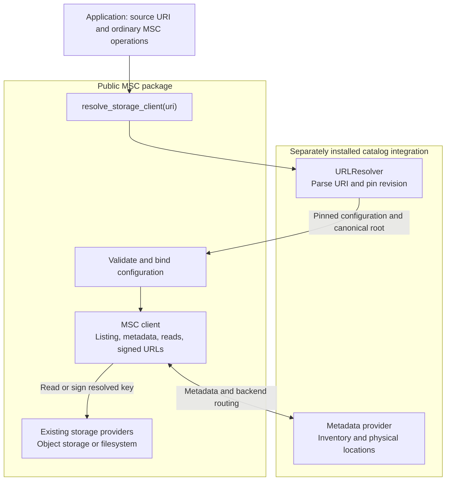
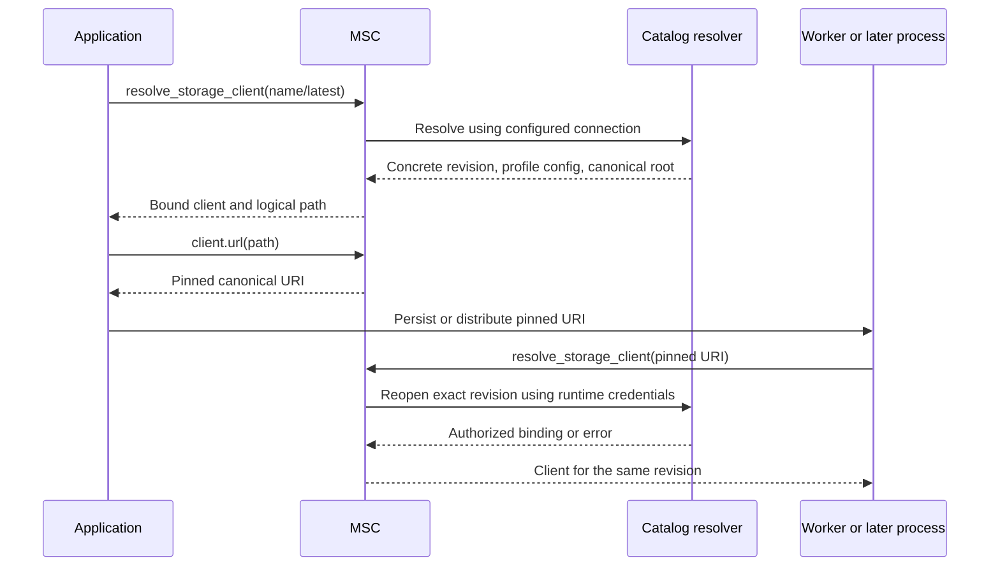

# Configurable reference resolution in MSC

**Status:** Draft for interface review. All APIs and configuration below are proposed unless marked existing.

## Problem and scope

A dataset catalog maps a dataset name and revision to a logical file inventory and backing storage locations. Today catalog access requires dataset-specific profile or provider configuration; `msc://profile/path` assumes that binding already exists. This proposal lets a configured resolver construct it from a reference URI. Applications continue to use MSC's existing listing, reading, and signing APIs.

Dataset Storage Service (DSS) is a motivating integration. Its external `nvdataset` provider resolves logical dataset paths to physical object locations, while MSC storage providers access the bytes. [Merged PR #190](https://github.com/NVIDIA/multi-storage-client/pull/190) describes this separation and identifies the provider as external to MSC. The proposed resolver follows the same boundary: service-specific parsing, authentication, and catalog access belong in the integration package. The examples use a fictional `catalog://` service and require no DSS installation.

The first delivery supports read-only dataset revisions through the Python API and existing storage backends. Catalog writes, automatic replica discovery, virtual-dataset materialization, and a general immutable-content API are outside scope. A pinned catalog revision fixes the inventory; it does not guarantee unchanged bytes in externally mutable objects.

## Public interface and ownership



Reuse the existing `provider_bundle` extension and `ProviderBundleV2` for metadata and backend delegation. Add one resolver per configured, non-reserved URI scheme, using MSC's existing `type` / `options` extension convention:

```yaml
url_resolvers:
  catalog:
    type: example_catalog.MSCResolver
    options:
      connections:
        research:
          endpoint: https://catalog.example.org
```

`example_catalog.MSCResolver` is illustrative. MSC constructs it as `MSCResolver(**options)`; the integration defines connection and authentication options. Configure the connection once, rather than defining a profile for each dataset. Import only explicitly configured classes, lazily when their scheme is used. Duplicate registrations and replacement of built-in schemes are configuration errors.

Proposed additions in `multistorageclient.references`:

```python
@dataclass(frozen=True)
class ResolvedURL:
    profile_config: dict[str, Any]
    canonical_root_url: str
    relative_path: str

class URLResolver(Protocol):
    def resolve(self, url: str) -> ResolvedURL: ...
```

`profile_config` is one JSON-compatible profile specification, validated with the existing profile schema. It contains the concrete binding and credential-provider references, not live clients or issued credentials. MSC assigns its internal profile name and inherits configured cache, retry, and telemetry settings. The canonical root is a hierarchical URI ending in `/`, without a query or fragment; `relative_path` is the decoded logical key beneath it.

Keep the existing `resolve_storage_client(url) -> tuple[StorageClient, str]`. Add `StorageClient.url(path: str = "") -> str`, returning the canonical root plus the encoded logical key for resolver-created clients. Existing profiles retain `msc://profile/path` formatting. Use this formatter consistently in URL-bearing list/glob results and `Path` operations.

## Resolve once and reopen elsewhere

The example integration accepts a mutable address and returns a pinned reference:

```text
Input:     catalog://research/datasets/by-name/images/revisions/latest/files/
Canonical: catalog://research/datasets/by-id/d123/revisions/r42/files/
```

The integration owns this grammar; MSC does not interpret dataset names or revision selectors. `research` must identify the same service namespace wherever the reference is reopened. A URI carries identity, not access permission; credentials come from the receiving process.

```python
import multistorageclient as msc

client, root = msc.resolve_storage_client(source_uri)
pinned_root = client.url(root)

for item in client.list(root):
    source_reference = client.url(item.key)
    # Save or send source_reference to another process.
```



MSC runs as a library in each caller's process. Each explicit resolution of `latest` may observe a newer revision. The returned client stays bound to its selected revision. Applications needing a consistent run resolve once before listing or distributing work; workers receive the canonical URI, never `latest`.

For previews or remote consumers, reopen the stored reference and request a fresh signed URL when the backend supports signing. Signed URLs are temporary transport addresses. Filesystem access does not imply an HTTP-signing capability.

## Required behavior and compatibility

- **Resolution order:** preserve explicit `msc://` profiles and path mappings; dispatch configured schemes after mappings, before the existing implicit-storage fallback. Unknown schemes, missing plugins/connections, and resolver failures raise errors without filesystem or bucket fallback.
- **Reconstruction:** retain both pinned configuration and canonical root in client serialization. Serialize `Path` using its bound canonical reference. The integration must reapply authorization and download restrictions when a process reconstructs the binding.
- **Cache isolation:** identify clients by configuration/authentication context and canonical binding, never dataset name alone. Integrations must expose non-secret context identifiers in their bound configuration when ambient context affects access. Context changes invalidate reuse. Profile identity must also distinguish revisions for path equality and sync overlap checks.
- **Path fidelity:** encode and decode logical keys exactly once. URI construction must preserve `%`, `?`, `#`, Unicode, literal dot segments, and trailing slashes without normalizing keys or escaping the canonical root. Existing MSC/storage URL semantics remain unchanged.
- **Delegation:** listing uses the metadata inventory; reads and signing resolve the logical key and selected backend first. Test single- and multi-backend clients. Missing inventory entries must not be recovered by guessing physical paths.
- **Read-only enforcement:** MSC marks all resolver-created bindings read-only and preserves that state during reconstruction. It rejects mutations and signing methods other than GET/HEAD before provider side effects, including writes through sync/copy destinations. A profile or metadata provider alone does not establish this restriction; the integration cannot enable writes in this first version.
- **Cost:** reuse clients for pinned bindings. Avoid network calls under a global cache lock. Core may coalesce identical in-flight resolutions; the integration may coalesce lookups across different keys. Choose metadata prefetch behavior in the integration for listing versus point-read workloads.

Explicit profiles continue to work without a resolver. Registration is opt-in and adds no catalog dependency to MSC. Python configuration owns dispatch; existing Python-to-Rust storage calls and `.pyi` signatures remain unchanged. Explorer, MCP, and framework-specific URL validators require a separate entrypoint audit before claiming support there.

## Implementation and acceptance

Paths are relative to the repository root.

| Files | Planned change |
|---|---|
| Under `multi-storage-client/src/multistorageclient/`: `references.py` (new), `config.py`, `schema.py`, `shortcuts.py` | Resolver contract/loading, validated bound configuration, dispatch, cache isolation. |
| Under `multi-storage-client/src/multistorageclient/`: `client/{client,types,single,composite}.py`, `pathlib.py` | Public facade, canonical URL formatting, read-only enforcement, bound serialization, consistent path identity. |
| `multi-storage-client/tests/test_multistorageclient/unit/` | Extend config, shortcuts, client, pathlib, serialization, and Ray tests with a synthetic catalog integration. |
| Under `multi-storage-client-docs/`: `src/user_guide/{concepts,quickstart}.rst`, `src/references/{configuration,api}.rst`, `examples/quickstart.ipynb` | Explain resolver configuration, canonical references, and application usage. |
| `.release_notes/.unreleased.md` | Describe the additive reference-resolution feature. |

Acceptance requires:

- [ ] Resolve, list, read, and sign a synthetic dataset whose logical and physical keys differ, with one and multiple backends; reject mutations and write-method signing before backend side effects.
- [ ] Reopen emitted URIs in a fresh process with only connection-level configuration; preserve the revision through `Path`, pickle, fork, and Ray handoff.
- [ ] A new `latest` resolution can advance while existing clients and saved references remain pinned; isolate revisions and caller contexts in caches and path comparisons.
- [ ] Preserve exact keys and existing explicit-profile/path-mapping/storage-URL behavior; fail clearly on missing plugins, ambiguous names, unavailable revisions, and denied access.

Run focused tests while developing, then client analysis, unit and Ray suites, documentation build, and `just build` before submission. The first public PR delivers the generic feature and synthetic tests; a separately packaged catalog adapter and application migration follow that contract.

Downstream DSS validation additionally covers the integration's authorization/download checks during reconstruction. It uses a private test setup and is separate from public PR acceptance; adapter implementation and service configuration remain outside MSC.

## Public precedent

- [PR #190](https://github.com/NVIDIA/multi-storage-client/pull/190), merged: external `nvdataset` metadata provider and logical-key resolution before signing.
- [Provider bundle configuration](https://github.com/NVIDIA/multi-storage-client/blob/6aaff00686c3c8da177ec9cfe512dd424e0f185b/multi-storage-client-docs/src/references/configuration.rst#L1414): existing generic multi-backend extension model.
- [PR #244](https://github.com/NVIDIA/multi-storage-client/pull/244), closed unmerged: names DSS as a downstream consumer. It provides discussion context, not evidence of shipped root-metadata behavior.
